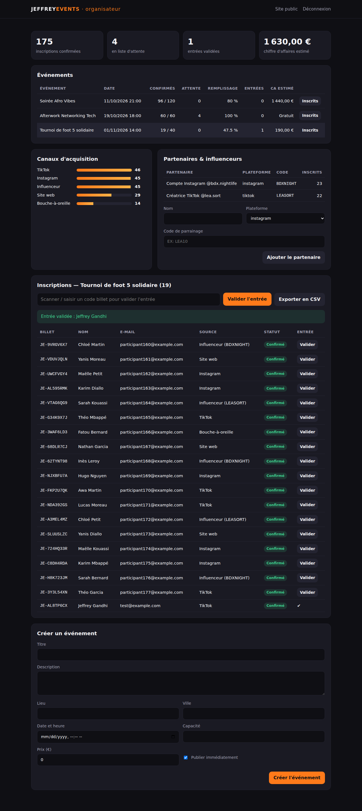

# JEFFREY EVENTS — Plateforme d'inscription aux événements

Plateforme full stack de la startup **JEFFREY EVENTS** (organisation de soirées, afterworks et tournois à Bordeaux). Elle permet aux participants de réserver leur place en quelques secondes. Côté organisateur, elle sert à piloter les événements : jauges, liste d'attente, contrôle à l'entrée et suivi des canaux d'acquisition (Instagram, TikTok, influenceurs).


## Fonctionnalités

**Participants**
- Liste des événements à venir avec les places restantes en temps réel
- Inscription avec validation des champs et consentement RGPD obligatoire
- Billet unique (`JE-XXXXXXXX`) remis immédiatement
- **Liste d'attente automatique** quand l'événement est complet, avec promotion automatique dès qu'une place se libère
- Consultation et annulation du billet
- Liens de parrainage influenceurs : `/?ref=CODE` préremplit le code partenaire

**Organisateur** (`/admin`, protégé par jeton)
- Tableau de bord : inscriptions, liste d'attente, entrées validées, chiffre d'affaires estimé
- Taux de remplissage et nombre d'entrées par événement
- **Canaux d'acquisition** (Instagram, TikTok, influenceurs, bouche-à-oreille…) et classement des partenaires par nombre d'inscrits
- Contrôle à l'entrée par code billet (un billet ne peut être scanné qu'une fois)
- Export CSV des inscrits (compatible Excel, protégé contre l'injection de formules)
- Création d'événements et de codes partenaires

**Analyse de données (Python)**
- Génère un rapport Markdown : remplissage, annulations, taux de présence, performance des canaux et des influenceurs
- Exports CSV prêts pour Power BI ou Excel



## Architecture

```
jeffrey-events/
├── src/                 API Node.js (Express)
│   ├── server.js        point d'entrée
│   ├── app.js           routes REST, authentification admin, export CSV, gestion des erreurs
│   ├── service.js       logique métier : jauges, liste d'attente, check-in, statistiques
│   ├── validation.js    validation des entrées
│   └── db.js            schéma SQLite (node:sqlite) et transactions
├── public/              front-end JavaScript (vanilla, modules ES)
│   ├── index.html       page publique
│   ├── admin.html       espace organisateur
│   ├── js/              app.js, admin.js, api.js
│   └── css/style.css
├── analytics/           module d'analyse Python (bibliothèque standard uniquement)
├── scripts/seed.js      données de démonstration
├── tests/               tests d'API (node:test)
└── Dockerfile, docker-compose.yml, .github/workflows/ci.yml
```

**Choix techniques**
- **SQLite intégré à Node.js** (`node:sqlite`) : aucune dépendance native et un seul fichier de base. Les inscriptions passent par des transactions `BEGIN IMMEDIATE`, pour qu'un événement ne puisse jamais dépasser sa capacité.
- Un **index unique partiel** empêche une même adresse e-mail de s'inscrire deux fois à un événement, tout en autorisant une réinscription après annulation.
- Le front n'injecte jamais de HTML : tout le texte passe par `textContent`, ce qui protège contre les failles XSS.
- Le jeton administrateur est comparé en temps constant (`crypto.timingSafeEqual`).
- Une seule dépendance npm : Express.

## Démarrage rapide

Prérequis : Node.js ≥ 22.13 et Python ≥ 3.10 pour l'analyse.

```bash
npm install
cp .env.example .env          # puis changez ADMIN_TOKEN
npm run seed                  # données de démonstration (facultatif)
npm start                     # http://localhost:3000  —  espace organisateur : /admin
```

Rapport d'analyse :

```bash
npm run report                # écrit reports/rapport-inscriptions.md + exports CSV
```

Avec Docker :

```bash
echo "ADMIN_TOKEN=un-jeton-long-et-secret" > .env
docker compose up --build
```

## Tests

```bash
npm test                                          # 9 tests d'API : jauges, liste d'attente, doublons, check-in, CSV…
cd analytics && python3 -m unittest -v test_report   # 4 tests du module d'analyse
```

L'intégration continue (GitHub Actions) exécute les deux suites à chaque push.

## API

| Méthode | Route | Accès | Description |
|---|---|---|---|
| GET | `/api/events?upcoming=true` | public | Événements publiés |
| GET | `/api/events/:id` | public | Détail d'un événement |
| POST | `/api/events/:id/registrations` | public | Inscription (ou liste d'attente) |
| GET | `/api/tickets/:code` | public | Consulter un billet |
| DELETE | `/api/tickets/:code` | public | Annuler (promeut la liste d'attente) |
| GET/POST | `/api/admin/events` | admin | Lister / créer des événements |
| PATCH/DELETE | `/api/admin/events/:id` | admin | Modifier / supprimer |
| GET | `/api/admin/events/:id/registrations(.csv)` | admin | Inscrits (JSON ou CSV) |
| POST | `/api/admin/tickets/:code/check-in` | admin | Valider l'entrée |
| GET/POST | `/api/admin/partners` | admin | Partenaires & influenceurs |
| GET | `/api/admin/stats` | admin | Statistiques du tableau de bord |

Les routes admin attendent l'en-tête `X-Admin-Token`.

## Pistes d'évolution

- Envoi du billet par e-mail avec QR code
- Paiement en ligne (Stripe)
- Génération des visuels d'événements avec un workflow IA (Stable Diffusion / ComfyUI)
- Comptes organisateurs multiples

---

Réalisé par **Jeffrey Gandhi** — [LinkedIn](https://www.linkedin.com/in/jeffrey-gandhi-48693a378) · Licence MIT
